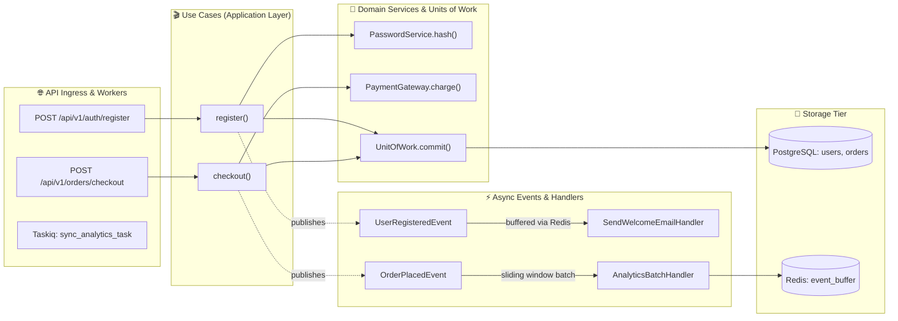

# 🏛️ ArchDoc

**Live Architecture Documentation & Contract Validator for Python Backends.**

[](https://pypi.org/project/archdoc/)
[](https://github.com/wecandevelopit/archdoc/actions/workflows/ci.yml)
[](https://www.python.org/downloads/)
[](https://obsidian.md/)
[](LICENSE)
[](https://github.com/astral-sh/ruff)

`archdoc` bridges the gap between fast-moving backend codebases and living technical documentation. It eliminates stale Confluence pages, manual Lucidchart diagrams, and unreadable AST import graphs.

Instead, `archdoc` reconstructs the **real execution topology** of your async backend:
- 🌐 **Ingress Entrypoints:** FastAPI routes, CLI commands, and Taskiq/Celery background workers.
- 🎬 **Application Workflows (Use Cases):** Step-by-step orchestrations, service invocations, and Unit of Work persistence.
- 🚀 **Domain Services & Ports:** Business logic, external integrations, and database operations.
- ⚡ **Asynchronous Messaging:** In-memory event dispatching, Redis batch buffers (sliding window / max size), and async handlers.
- 💾 **Storage Tier:** Relational SQLAlchemy models (PostgreSQL), cache/buffer keys (Redis), and analytical logs (ClickHouse).

---

## 🗺️ Live Architecture Topology

`archdoc` traces code top-down—from API entrypoints all the way down to database writes and distributed events:



---

## 🔮 Dual Delivery Model

```
                    ┌────────────────────────┐
                    │ Python Backend Codebase│
                    └───────────┬────────────┘
                                │
                        [ archdoc scan ]
                                │
         ┌──────────────────────┼──────────────────────┐
         ▼                                             ▼
┌───────────────────────────┐             ┌───────────────────────────┐
│     Obsidian Vault        │             │    AI Coding Context      │
│  (For Developers & Leads) │             │     (For AI Agents)       │
├───────────────────────────┤             ├───────────────────────────┤
│ • [[wikilinks]] graph     │             │ • architecture_context.md │
│ • Mermaid flowcharts      │             │ • Pydantic contract specs │
│ • Bounded Context MOCs    │             │ • Route -> UC -> DB map   │
│ • Portable relative paths │             │ • Zero hallucination      │
└───────────────────────────┘             └───────────────────────────┘
```

---

## 🖥️ Visual Showcase

### 1. Interactive Obsidian Vault & Graph View

When opening the generated documentation folder in [Obsidian](https://obsidian.md), every use case, domain service, event, and database model connects into an interactive knowledge graph:

```
📁 docs/architecture/
├── 📄 index.md                         # Architecture overview MOC with system-wide Mermaid diagram
├── 📁 domains/                         # Domain Bounded Contexts
│   ├── 📄 auth.md                      # Auth context: routes, use cases, entities
│   └── 📄 orders.md                    # Orders context
├── 📁 use_cases/                       # Granular workflows with docstrings & call graphs
│   ├── 📄 register.md
│   └── 📄 checkout.md
├── 📁 services/                        # Domain & infrastructure services
│   ├── 📄 password_service.md
│   └── 📄 payment_service.md
├── 📁 events/                          # Pydantic v2 event schemas & handlers
│   ├── 📄 user_registered.md
│   └── 📄 order_placed.md
└── 📁 datastore/                       # Database tables, Redis buffers & ClickHouse logs
    ├── 📄 postgres_users.md
    └── 📄 redis_event_buffer.md
```

#### Obsidian Graph View (ASCII Representation)

```
              [POST /register]
                     │
                     ▼
           [[register (use_case)]]
             /               \
            ▼                 ▼
[[PasswordService]]     [[UnitOfWork]] ──────► [(PostgreSQL: users)]
            \                 /
             ▼               ▼
           [[UserRegisteredEvent]]
                     │
                     ▼
       [[SendWelcomeEmailHandler]]
```

---

### 2. Rich CLI Execution

Run `archdoc generate .` in your terminal to view interactive scanning progress and a detailed summary table:

```
╭─────────────────────────────── ArchDoc Analysis ──────────────────────────────╮
│ Project: InventX Backend  •  Python: 3.12.10  •  Roots: src/                  │
╰───────────────────────────────────────────────────────────────────────────────╯
 Scanning source files: ━━━━━━━━━━━━━━━━━━━━━━━━━━━━━━━━━━━━━━━━ 100% 0:00:01

┏━━━━━━━━━━━━━━━━━━━━━┳━━━━━━━┳━━━━━━━━━━━━━━━━━━━━━━━━━━━━━━━━━━━━━━━━━━━━━━━━┓
┃ Component Type      ┃ Count ┃ Highlights                                     ┃
┡━━━━━━━━━━━━━━━━━━━━━╇━━━━━━━╇━━━━━━━━━━━━━━━━━━━━━━━━━━━━━━━━━━━━━━━━━━━━━━━━┩
│ Ingress Endpoints   │    18 │ FastAPI routes, Taskiq brokers                 │
│ Use Cases           │    12 │ register, login, checkout, refresh_token       │
│ Domain Services     │     8 │ PasswordService, TokenService, OrderService    │
│ Event Models        │     6 │ Pydantic v2 schemas with field typing          │
│ Event Handlers      │     7 │ In-memory & Redis sliding-window batch workers │
│ Storage Models      │    14 │ PostgreSQL (SQLAlchemy 2.0), Redis keys        │
└─────────────────────┴───────┴────────────────────────────────────────────────┘
✔ Obsidian Vault written to: docs/architecture/
✔ AI Agent context written to: docs/architecture_context.md
✔ Machine-readable IR written to: docs/architecture_graph.json
```

---

### 3. CI/CD Contract Guard (Pull Request Diff)

Prevent silent schema breaks between frontend and backend, or producer and consumer services. `archdoc diff` flags breaking contract changes before merging:

```
🚨 ARCHITECTURE CONTRACT VIOLATION DETECTED

❌ BREAKING CHANGES (2):
  • Event 'UserRegisteredEvent': Removed required field 'user_id' (UUID)
  • Event 'OrderPlacedEvent': Type of field 'total_amount' changed from Decimal to float

⚠️  COMPATIBLE CHANGES (1):
  • Event 'UserRegisteredEvent': Added optional field 'locale' (str = "en")

Process exited with code 1.
```

---

## 🚀 Quick Start

### Installation

Install via `uv` (recommended):

```bash
uv pip install archdoc
```

Or via standard `pip`:

```bash
pip install archdoc
```

Or run directly without installation via `uvx`:

```bash
uvx archdoc generate .
```

---

## 🛠️ Usage

### 1. Generate Living Documentation

```bash
# Scan current directory and generate docs:
archdoc generate .

# Or scan an external repository and specify custom outputs:
archdoc generate /path/to/my-backend \
  --obsidian ./docs/architecture \
  --agent ./docs/architecture_context.md \
  --ir ./docs/architecture_graph.json
```

### 2. Fast Architecture Contract Check

Verify that all event schemas, handlers, and use-case references are valid:

```bash
archdoc check .
```

### 3. Compare Snapshots in CI/CD

Compare a PR branch against `main` to catch breaking changes:

```bash
# Generate baseline snapshot from main:
archdoc generate .main-baseline --ir main_graph.json

# Compare current working directory against baseline:
archdoc diff main_graph.json . --fail-on-breaking
```

---

## 🤖 Empowering AI Coding Agents

Modern AI coding agents (Antigravity, Cursor, Claude Code, GitHub Copilot) write better code when they understand the **holistic architecture** instead of guessing from isolated files.

Add this instruction to your project's `AGENTS.md` or `.cursorrules`:

```markdown
### Architecture Context
Before writing or modifying any route, use case, or event handler:
1. Refer to `docs/architecture_context.md` for existing bounded contexts and contracts.
2. Follow the existing flow: Route -> Use Case -> Service / Unit of Work -> Event.
3. Keep docstrings formatted in Sphinx/reST format.
4. Regenerate architecture context using `archdoc generate .` after modifying signatures.
```

---

## ⚙️ Configuration (`archdoc.yaml`)

`archdoc` works out of the box with zero configuration for standard layouts. For custom projects, create `archdoc.yaml` in the repository root:

```yaml
project_name: "My Awesome Backend"

# Source code directories
source_roots:
  - "src"

# Discovery paths
events_paths:
  - "src/core/domain/events"
handlers_paths:
  - "src/infrastructure/handlers"
use_cases_paths:
  - "src/core/use_cases"

# Output destinations
output_obsidian_dir: "docs/architecture"
output_agent_context_file: "docs/architecture_context.md"
output_ir_json_file: "docs/architecture_graph.json"

# AST decorator matchers
route_decorators:
  - "router.get"
  - "router.post"
  - "router.put"
  - "router.delete"
  - "router.patch"
handler_decorators:
  - "event_handler"
  - "batch_event_handler"
taskiq_task_decorators:
  - "broker.task"
```

---

## 🪝 Pre-commit Integration

Add `archdoc` to `.pre-commit-config.yaml` to keep documentation synchronized automatically with every commit:

```yaml
repos:
  - repo: https://github.com/wecandevelopit/archdoc
    rev: v0.1.0
    hooks:
      - id: archdoc-generate
      - id: archdoc-check
```

---

## 📦 GitHub Actions Workflow

Ensure PRs never silently break event contracts by adding a contract diff check to `.github/workflows/contract-diff.yml`:

```yaml
name: Architecture Contract Diff

on:
  pull_request:
    branches: [main, master]

jobs:
  contract-diff:
    runs-on: ubuntu-latest
    steps:
      - name: Checkout PR branch
        uses: actions/checkout@v4

      - name: Checkout baseline main branch
        uses: actions/checkout@v4
        with:
          ref: main
          path: .main-baseline

      - name: Install uv
        uses: astral-sh/setup-uv@v5

      - name: Generate baseline snapshot
        run: uvx archdoc generate .main-baseline --ir main_graph.json

      - name: Run Contract Diff Check
        run: uvx archdoc diff main_graph.json . --fail-on-breaking
```

---

## 📝 Docstrings Standard (reST format)

`archdoc` parses docstrings to populate summaries, parameters, return types, and exceptions. Use Sphinx/reST format for optimal rendering:

```python
async def register(
    *,
    name: str,
    email: str,
    password: str,
    password_service: PasswordService,
    id_provider: IDProvider,
    db_uow: UnitOfWork,
) -> User:
    """
    Register a new user in the platform.

    :param name: Unique display name
    :param email: User email address (must be unique)
    :param password: Plain-text password to hash
    :param password_service: Password hashing & verification service
    :param id_provider: Provider for generating public UUIDs
    :param db_uow: Database unit of work
    :return: Newly created User entity
    :raises UserAlreadyExists: If a user with the same email already exists
    """
    ...
```

---

## 🤝 Contributing

Contributions are welcome! Please follow these steps:

1. Fork the repository.
2. Create your feature branch (`git checkout -b feature/amazing-feature`).
3. Install dependencies: `uv sync --all-groups`.
4. Run tests & linters:
   ```bash
   uv run ruff check .
   uv run pytest -v
   ```
5. Commit your changes and open a Pull Request.

---

## 📄 License

This project is licensed under the MIT License — see the [LICENSE](LICENSE) file for details.
